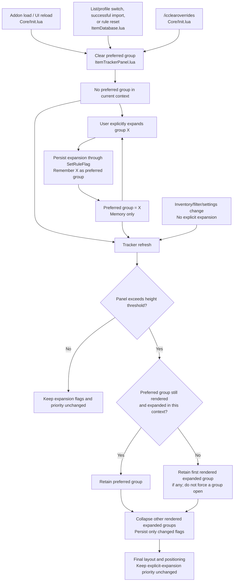

# Adaptive Tracker Panel Sizing: Implementation and Verification

**Status:** Implemented, reviewed, released, and verified; isolated regression
suite passed.

## Implementation Record (2026-10-30)

- Added the account-wide **Maximum Visible Rows** setting with a default of 20
  and a range of 5-50 rows. The title is outside the item-area budget.
- The tracker keeps the preferred wrapped layout when it fits, temporarily
  switches to single-line names when needed, applies the category expansion
  policy, and scrolls any remaining overflow. Scroll state and the fixed title
  are preserved by the viewport layout.
- The isolated Lua 5.1 regression runner passed **71/71 tests**, including
  tracker layout, expansion, scroll, context-change, and synthetic performance
  checks. The runner also syntax-checked addon Lua files.
- The feature shipped in reviewed code and is considered in-game verified
  under the project release-verification policy.
- Later planning sections and checklists preserve historical proposals and
  unrelated work; unchecked boxes there are not outstanding requirements for
  the released adaptive sizing feature. The original height-constraint and
  separate-mode proposals are closed, not deferred work.

## Updated Implementation Direction (2026-10-29)

**This section supersedes conflicting scope, settings, overflow, and test
assumptions in the earlier plan below and in the linked requirements.**
The earlier implementation map remains reference material, not an instruction
to implement the superseded pixel/UI-unit limit or collapse-only release.

### Goal and Settings

- Preserve the existing **Tracker Group Threshold** setting: below that number
  of visible item types, show the flat list; at or above it, use categories.
- Add an account-wide **Maximum Visible Rows** setting instead of a maximum
  height in pixels or UI units. Working values for testing: default **20**,
  range **5-50**, in whole-row steps.
- Keep the panel compact when content is short. Bound its item viewport by the
  row budget, with scrolling as the final fallback so every item stays accessible.
- Keep the title and edit control fixed outside the scrolling item area and
  outside the row budget.

### Row Counting and Fallback Order

1. Try the candidate layout with the user's preferred multiline setting.
   Each category header or single-line item uses one row; a wrapped item uses
   its actual number of displayed lines (two lines count as two rows, three as
   three). Count only visible content, not hidden or filtered-out items.
2. If the candidate exceeds the budget, switch the whole item area to
   **single-line names**, with ellipses for long names, before collapsing any
   categories. This is a temporary rendering choice: do not overwrite the saved
   multiline preference. Restore wrapping when the preferred layout fits again.
3. If single-line content still exceeds the budget, apply the category rules
   below.
4. If collapsing cannot satisfy the budget, **scroll** the item area. This must
   handle a single oversized category, too many collapsed category headers,
   and an oversized flat list without truncating or dropping items.

The priority is **wrapping -> single-line -> collapse -> scroll**. Once in
single-line format, each header/item consumes exactly one row. Fit includes
equality: a layout at the budget does not trigger the next fallback.

### Category Expansion Rules

- If all eligible categories fit fully expanded, open them all. Try the
  preferred multiline format first, then single-line format, before deciding
  that categories need to remain collapsed.
- If the user explicitly opens a category and the resulting layout fits, open
  it and leave the other categories unchanged.
- If explicit expansion still exceeds the budget after the single-line
  fallback, keep the chosen category open and collapse **all other rendered
  expanded categories**, not just enough categories to fit.
- If that category plus the remaining headers still cannot fit, keep it open
  and use scrolling.
- Remember expansion choices across refreshes/reloads. A category becoming
  visible or having its filter/totals settings changed is re-evaluated:
  introduce it expanded if it fits alongside the current layout after the
  formatting fallback; otherwise introduce it collapsed. Unlike explicit
  expansion, this must not displace other open categories.
- Respect explicit manual collapse. Do not immediately undo it with the
  open-all-if-it-fits rule; evaluate that rule on initial layout or relevant
  content/settings changes, not as a response to the collapse itself.
- Ordinary pickups update content and totals and enforce the budget; they are
  not an explicit request to open the receiving category.
- **Passive inventory overflow:** First try single-line formatting. If the
  panel still exceeds the row budget and exactly one already-open category
  grew in displayed content, retain that category and collapse all other
  rendered expanded categories. "Grew" means its contents grew, not that a
  collapsed category was automatically opened.
- Never automatically open a previously collapsed category to handle an
  inventory update. If no uniquely affected already-open category can be
  identified, collapse all rendered expanded categories rather than choosing
  by last-click history or arbitrary display order.
- Evaluate rapid inventory updates together. If several already-open
  categories grew in the same burst, collapse all on overflow; do not jump
  between event-by-event winners. If the retained category or the collapsed
  headers still exceed the budget, use scrolling.
- Keep pre-update expansion/content comparisons scoped to the current
  tracked-list context; do not attribute profile switches or settings-driven
  reintroduction to inventory growth. Use existing rule setters for persisted
  expansion changes.
- Pickup highlighting, automatic opening of receiving categories, and
  collapse-on-login options remain deferred.

### Implementation and Acceptance

- Implement one adaptive policy, not separate user-selectable Collapse/Scroll
  modes. Separate candidate layout, temporary wrapping fallback, category
  decisions, and bounded viewport layout sufficiently to avoid refresh loops.
- Use standard ESO scrolling controls. Preserve scroll position on routine
  refreshes where possible, clamp it after content shrinks, and keep an
  explicitly opened header visible. Account for scrollbar width when laying
  out names and counts.
- Reserve the standard scrollbar width consistently so scrollbar visibility
  does not introduce a wrapping/layout feedback loop. Measure candidate
  wrapping with one pooled label; expansion trials use category row totals,
  not trial rendering of every member row.
- Preserve group clicks, context menus, dragging, saved position, editor
  avoidance, and interaction positioning. Derive viewport dimensions from
  actual row dimensions and spacing; the user-facing policy requires no
  resolution-specific row-budget conversion. Retain a screen-fit safety bound.
- Test exact-budget and over-budget layouts, two-/three-line names, restoration
  of wrapping without preference mutation, all-expanded fit, manual collapse,
  explicit expansion versus settings-driven reintroduction, remembered state,
  profile changes, a single oversized category, excessive headers, and flat
  lists.
- Test passive overflow with one growing already-open category, a previously
  collapsed receiving category, no unique growing open category, and bursts
  growing multiple open categories. Verify no collapse when single-line
  formatting suffices, no automatic opening of collapsed categories, and no
  event-by-event category switching within a burst.
- Verify in game that wheel/scrollbar input works and no items become
  inaccessible. Validate readability and positioning separately from isolated
  synthetic tests.

### Layout Performance and Unit Tests

Extend the existing isolated runner with
[TrackerPanelTests.lua](../../Tests/TrackerPanelTests.lua). Exercise the actual
tracker policy and refresh path with synthetic inventory and instrumented ESO
control mocks, not a separate test-only implementation. Existing scan/matching
timings do not cover tracker layout.

Implementation constraints to verify:

- Build the inventory snapshot and category/item model once per refresh.
  Evaluate expansion candidates using in-memory counts; do not rescan inventory
  or render every category combination.
- Reuse pooled controls and bound text-measurement/layout passes. Account for
  scrollbar-width changes explicitly rather than iterating until convergence.
- Trial layouts must not mutate saved rules. Persist only final expansion
  decisions and never overwrite the saved multiline preference.

| Test | Required assertion |
|---|---|
| Snapshot reuse | All-expanded trials, wrapping fallback, collapse, and final rendering together build only one inventory snapshot per refresh. |
| Candidate evaluation | Exercise all-expanded fit, explicit overflow, and passive overflow with instrumented counters; candidate evaluation does not perform additional inventory scans or combinatorial rendering. |
| Warm control pool | After warming enough rows, repeated refreshes of equal or smaller content create no additional row controls. |
| Bounded layout work | Assert explicit measurement/layout-pass ceilings for wrapping, single-line fallback, and scrollbar appearance/disappearance. Set the concrete ceilings from the implementation structure before accepting results; do not use elapsed time as a substitute. |
| Burst coalescing | A synthetic burst through the existing event queue produces one settled tracker refresh, evaluates all affected categories together, and does not render event-by-event winners. |
| Persistence isolation | Trial decisions write no saved expansion flags; the final policy writes only changed flags. An unchanged refresh writes none, and formatting fallback never writes the multiline preference. |
| Small/large workloads | Time repeated refreshes for deterministic small and large synthetic trackers, including one oversized category and many categories. Record workload sizes, iterations, and explicit limits; compare equivalent workloads before/after the layout change rather than choosing limits merely to pass. |
| Worst fallback path | Exercise wrapping overflow, single-line overflow, category collapse, and remaining scroll overflow together; assert both the expected final rows and bounded work. |

Use operation-count assertions as the deterministic regression guard and timing
checks as additional evidence. Keep all synthetic state and persistence writes
isolated from live inventory and saved variables.

Mocked controls cannot measure ESO's real text/layout cost. Supplement the unit
tests with safe in-game timing of the actual refresh path for representative
small and oversized lists, separating cold control creation from warmed
refreshes. Report these results separately from isolated-test timings.

### Group Editor Font Fixes (Same Release)

- Fix the tiny text in the group editor's pattern/rule edit boxes and search
  field in [EditPanelGroupsTab.xml](../../../Tracking/EditPanelGroupsTab.xml).
  Replace `AS_FontEditbox` with `ZoFontWinT1` and increase input heights to
  30 UI units; verify this candidate fix in game.
- `AS_FontEditbox` has no definition in this addon. Use a standard ESO font
  rather than relying on another addon to define it. The undefined reference
  is a suspected cause, not yet a visually verified diagnosis.
- Verify that pattern text is readable and properly positioned within each
  field, rather than tiny at the top-left as in the user screenshot. Check
  font validity and inherited edit-box behaviour before adding padding or
  alignment changes; avoid treating this as a general resolution-scaling bug.
- Apply the equivalent search-input fix in
  [EditPanelItemsTab.xml](../../../Tracking/EditPanelItemsTab.xml) so the two
  editors use consistent, self-contained fonts.
- Check existing pattern text, newly added patterns, typing, focus/save
  behaviour, and clipping at 2560x1440 and the developer's normal UI scale.
  The candidate fix is not considered verified until checked in game.
- Apply the separate tracker-title readability fix, replacing
  `ZoFontGameSmall` with `ZoFontGame`. Preserve the original tracker item/count
  fonts and 22-unit rows; those rows were not identified as a problem.
- A font-scale slider is deferred pending in-game verification of the
  corrected fonts.

## Earlier First-Round Plan (Reference; Conflicts Superseded Above)

**Behavior reference:** [Requirements and decisions](TrackerPanelHeightConstraints.md),
section C. Sections F (scrolling/mode choice) and G (follow inventory changes)
are deferred entirely, including their outstanding decisions.

## A. First-Round Scope

- Add an account-wide maximum-height preference, defaulting to 600 UI units,
  with a proposed working minimum of 200 and 20-unit steps. Allow selection of
  the exact full-screen height.
- When the rendered tracker exceeds the threshold, retain the active expanded
  group and collapse all other rendered expanded groups.
- Check on ordinary refreshes as well as explicit expansion. Prefer the last
  explicitly expanded group in the current tracking context; otherwise use the
  first rendered expanded group.
- Persist automatic collapses through the existing delta-only rule setter.
- Allow residual overflow when the retained group, headers, or flat list alone
  exceeds the limit. This round implements a collapse threshold, not a hard cap.
- Do not add a scrollbar, behavior-mode setting, or inventory-follow setting.

## B. Implementation Pieces and File Ownership

| Piece | Files | Responsibility |
|---|---|---|
| B1. Saved preference and loading | [Core/Constants.lua](../../../Core/Constants.lua), [Core/Init.lua](../../../Core/Init.lua) | Add `trackerMaxHeight = 600` to account defaults. Validate the loaded value before tracker initialization; missing values inherit the default, malformed external values report an error. Store UI units directly, without resolution conversion or a saved-variable version bump. |
| B2. Settings control | [Core/Settings.lua](../../../Core/Settings.lua) | Add the height slider to the existing tracker submenu. Allow the exact full-screen endpoint, including when it does not align with the normal step. Explain collapse-threshold behavior and residual overflow. Refresh immediately after changes. |
| B3. Active-group intent | [Tracking/ItemTrackerPanel.lua](../../../Tracking/ItemTrackerPanel.lua) | Record explicit group expansion and prefer that group during overflow handling. Keep this priority in memory only. Existing no-argument refresh callers continue working. |
| B4. Tracking-context lifecycle | [Tracking/ItemDatabase.lua](../../../Tracking/ItemDatabase.lua), [Core/Init.lua](../../../Core/Init.lua), [Tracking/ItemTrackerPanel.lua](../../../Tracking/ItemTrackerPanel.lua) | Clear stale expansion priority on list/profile switches, imports, and rule resets, including `/icclearoverrides`. Use one small context-reset mechanism at the existing mutation entry points. Do not clear priority on every rule-cache invalidation: normal expansion and automatic collapsing invalidate that cache too. |
| B5. Height measurement and collapse policy | [Tracking/ItemTrackerPanel.lua](../../../Tracking/ItemTrackerPanel.lua) | Measure after real row layout, select the retained group deterministically, persist only necessary collapses, and remove their member rows from the final display. Include Miscellaneous and leave non-rendered rules unchanged. |
| B6. Final layout and positioning | [Tracking/ItemTrackerPanel.lua](../../../Tracking/ItemTrackerPanel.lua) | Relayout once after collapsing, recomputing shared count/name widths and wrapped heights. Apply existing screen positioning using final dimensions. Preserve row pooling, click handlers, dragging, and interaction/editor positioning. |
| B7. Isolated verification | New [Project/Tests/TrackerPanelTests.lua](../../Tests/TrackerPanelTests.lua), [Project/Tests/Run-RuleTests.py](../../Tests/Run-RuleTests.py) | Add a focused Lua test suite with synthetic inventory and mocked controls, loaded by the existing isolated runner. Exercise actual tracker refresh/click behavior, preference loading, and context resets without live saved variables. |
| B8. Documentation and acceptance | [UserManual.bbcode](../../../UserManual.bbcode), [Project/DevDocs/TODO.md](../TODO.md), [requirements plan](TrackerPanelHeightConstraints.md) | The user manual documents the row budget and adaptive fallbacks. The reviewed release and automated verification recorded above complete this work. |

Keep layout helpers local to the tracker where possible. No new runtime module,
general layout framework, or dependency is planned.

### B4a. Tracking-Context Lifecycle Diagram

This is the proposed lifecycle of the **in-memory preferred group**, not the
persisted expansion flags. Clearing priority does not itself open or collapse
any group.

### B4b. Lifecycle Rules and Ownership

- **Context boundaries:** successful list/profile switches, imports, and rule
  resets clear priority before the next tracker refresh. A failed import must
  not clear it or otherwise change the active context.
- **Explicit expansion:** the tracker remembers the clicked group after its
  expansion flag is saved. This is the only action that establishes a new
  preferred group; passive refreshes and fallback selection do not.
- **Manual collapse:** save the collapse normally. A remembered group that is
  now collapsed is ineligible for retention; do not reopen it automatically.
- **Temporary disappearance:** a remembered group that is filtered out or has
  no rendered header is likewise ineligible. Its remembered identity may remain
  within the same context; eligibility is checked on each refresh.
- **Rule-cache invalidation is separate:** `SetRuleFlag` invalidates the rule
  cache during manual expansion and automatic collapsing. That must not trigger
  the context reset, or the user's explicit preference would immediately vanish.
- **Reload:** saved expansion flags survive, but the preferred identity does not.
  Until another explicit expansion, overflow uses display-order fallback.

### B7a. Preference and Settings Tests

All B7 tests are planned isolated tests, not yet implemented or executed.
Use synthetic profiles and mocked ESO controls/APIs; never live saved variables
or inventory. Heights below are complete panel heights in UI units.

| ID | Setup/action | Expected result |
|---|---|---|
| B7a1 | Load a profile without `trackerMaxHeight`. | Default is 600; unrelated saved values remain unchanged. |
| B7a2 | Load valid values at 200, 600, and the full-screen endpoint. | Each value is accepted and retained unchanged in UI units. |
| B7a3 | Load a string, boolean, table, NaN, infinity, or a value outside the persisted range. | Each malformed value produces an explicit validation error before tracker initialization; no silent replacement or unrelated mutation. |
| B7a4 | Mock a screen height of 1447 and inspect/use the slider. | Exact maximum 1447 is selectable despite the 20-unit step and former 1200 ceiling. |
| B7a5 | Change height from 600 to 400 through the settings callback. | Save 400 and request one immediate tracker refresh; do not change unrelated preferences. |
| B7a6 | Mock saved height 600 and available screen height 500. | Effective threshold is 500; no physical-resolution conversion rewrites the saved 600. |

### B7b. Threshold and Group Selection Tests

| ID | Setup/action | Expected result |
|---|---|---|
| B7b1 | Render two expanded groups at total height 599 with limit 600. | Both stay open; no automatic flag writes. |
| B7b2 | Render the same groups at exactly 600. | Both stay open; equality does not trigger collapsing. |
| B7b3 | Explicitly expand B, producing height 601 with A and B open. | B stays open; A is saved collapsed; A's member rows disappear and its header shows collapsed state. |
| B7b4 | Expand B with A, B, and C open; closing A alone would make the panel fit. | Both A and C collapse, not just enough groups to fit. |
| B7b5 | At overflow, provide expanded rules whose groups are hidden or not rendered. | Their flags remain unchanged; only other rendered expanded groups collapse. |
| B7b6 | Last explicit expansion is B; increase its item rows through a passive refresh until overflow. | B is retained, even if A is first in display order. |
| B7b7 | Load an overflowing panel with no preferred group. | Retain the first rendered expanded group in display order, independent of rule table insertion order. |
| B7b8 | Preferred B is filtered out, or is now collapsed; A and C remain expanded at overflow. | Use the first eligible expanded group; never reopen B. |
| B7b9 | Miscellaneous is explicitly expanded and causes overflow. | Retain Miscellaneous and collapse other rendered expanded groups using their own rule identities. |
| B7b10 | Manually collapse preferred B while remaining groups fit. | B stays collapsed; no other group is forced open. |
| B7b11 | Render one expanded group whose panel height remains 800 at limit 600. | Keep that group open and allow documented overflow; do not loop or truncate its members. |
| B7b12 | Render collapsed group headers alone taller than the limit. | Preserve all headers, open no group, and allow overflow without flag writes. |
| B7b13 | Render a flat list taller than the limit, then cross the grouping threshold. | Flat mode makes no group-flag changes; grouped mode applies the normal policy on its next refresh. |
| B7b14 | Render no visible items. | Existing empty-state row appears; no collapse mutations occur. |

### B7c. Lifecycle and Persistence Tests

| ID | Setup/action | Expected result |
|---|---|---|
| B7c1 | Explicitly expand B, including the resulting rule-cache invalidation, then refresh into overflow. | B remains preferred; cache invalidation does not clear priority. |
| B7c2 | Automatically collapse A while retaining B, then refresh again. | B remains preferred; A stays collapsed; no duplicate collapse writes occur. |
| B7c3 | Switch between account-wide and character-specific lists after preferring B. | Clear priority before the new list is rendered; overflow uses that list's display order and does not mutate the inactive list. |
| B7c4 | Successfully import/copy a profile after preferring B. | Clear old priority; retain imported flags unless the new layout itself requires collapsing. |
| B7c5 | Reject an invalid profile import. | Preserve the active profile, expansion flags, and preferred group. |
| B7c6 | Reset a rule or invoke `/icclearoverrides` after preferring B. | Clear priority; use current post-reset rules and display-order fallback on overflow. |
| B7c7 | Simulate UI reload from saved synthetic data after automatic collapsing. | Collapsed flags persist; preferred identity is absent; the first overflowing refresh uses display-order fallback. |
| B7c8 | Automatically collapse built-in and custom groups in separate cases. | Persist through `SetRuleFlag` with existing delta/pruning semantics; do not copy full resolved rules or change patterns, names, notification/bank flags, or unrelated profile data. |
| B7c9 | Lower the limit so the current panel overflows, then raise it again. | Lowering applies the retention policy; raising does not automatically reopen collapsed groups. |
| B7c10 | Filter preferred B out, refresh, then restore B within the same context. | While absent it is ineligible; if still expanded when restored, its remembered preference is eligible again. |
| B7c11 | Add/remove items without an explicit expansion. | Never automatically open a collapsed group or transfer preference to the changed item's group; extension G is excluded. |

### B7d. Layout and Bounded-Work Tests

| ID | Setup/action | Expected result |
|---|---|---|
| B7d1 | Supply mocked wrapped text heights that push the total above 600 while row count alone would fit. | Collapse based on final measured row heights, not a fixed row-count estimate. |
| B7d2 | Make rows alone fit but title, first-row gap, inter-row gaps, and panel padding push total over 600. | Full panel measurement triggers the policy at the correct threshold. |
| B7d3 | Collapse the group containing the widest count label. | Recompute shared count/name widths and wrapped heights for the final row set. |
| B7d4 | Refresh a tall panel into a much shorter final list using pooled controls. | Surplus rows are hidden and excluded from measured content; visible anchors are rebuilt correctly. |
| B7d5 | Reuse a group-header row for a different group, then click it. | Click toggles the new group, and its +/- icon matches the final expansion state. |
| B7d6 | Instrument snapshot acquisition and row-layout passes during overflow. | One inventory snapshot and exactly two layout passes when collapse changes the display; no recursive refresh or per-group scan. |
| B7d7 | Instrument a fitting panel and an irreducibly overflowing panel. | One snapshot and one layout pass each; irreducible overflow does not retry indefinitely. |
| B7d8 | Start near screen bottom and collapse a candidate panel to a shorter final panel. | Position is bounded using final height, not the pre-collapse candidate; automatic positioning does not overwrite saved drag coordinates. |
| B7d9 | Disable the tracker before refreshing. | Panel is hidden; no snapshot acquisition, layout, or automatic expansion mutations occur. |
| B7d10 | Generate a synthetic burst ending with many groups and item rows, then run normal refresh calls. | Every refresh respects the bounded-work assertions and produces deterministic retention; record timing without inventing a performance pass threshold. |

Mocked controls verify policy and arithmetic, not ESO's native auto-sizing or
input behavior. In-game acceptance remains required for measurement timing,
pooled-row sizing, actual wrapping, dragging, and editor/interaction positioning.

## C. Refresh Flow

1. Return through the existing hidden-panel path when the tracker is disabled.
2. Resolve the current tracking context and any explicit expansion intent.
3. Acquire one inventory snapshot and build the candidate display list.
4. Lay out rows using existing count-column widths and name wrapping.
5. Measure the complete panel in UI units, including title, gaps, and padding.
6. If above the effective limit and multiple rendered groups are expanded:
   - Retain the preferred group, or the first rendered expanded group.
   - Save `isExpanded = false` for the other rendered expanded groups through
     `SetRuleFlag`.
   - Update header state and filter those groups' member rows from the already
     collected display data. Do not acquire another inventory snapshot.
   - Relayout the final rows once.
7. Position the panel using the final height.

At or below the threshold, make no automatic expansion changes. With no other
expanded group to collapse, accept the documented residual overflow. Avoid
recursive refreshes and shrink-until-fit loops.

## D. Layout Boundary

[Tracking/ItemTrackerPanel.xml](../../../Tracking/ItemTrackerPanel.xml) is
expected to remain unchanged: first-round behavior keeps the existing
resize-to-fit panel rather than introducing a capped viewport.

Verify ESO's actual measurement timing and whether pooled hidden rows affect
auto-sizing early in implementation. If existing XML sizing prevents accurate
measurement, make only the directly necessary layout adjustment; do not
silently expand scope into the deferred scrolling extension.

## E. Build Order and Verification

1. **Preference:** implement defaults, loading validation, and settings control.
2. **Intent lifecycle:** implement explicit-expansion priority and context reset
   wiring before relying on that priority for automatic collapses.
3. **Layout policy:** implement the bounded candidate/final layout flow.
4. **Automated checks:** cover threshold equality, overflow, wrapped names,
   Miscellaneous, hidden groups, manual collapse, passive growth, flat/empty
   lists, profile/reset behavior, persistence, full-height selection, and
   irreducible overflow. Assert one inventory snapshot and at most two row
   layout passes per refresh.
5. **Regression command:** extend and run the existing
   `python Project\Tests\Run-RuleTests.py` suite, including its Lua 5.1 syntax
   checks. Use only synthetic data for burst/performance checks.
6. **In-game acceptance:** verify real dimensions, full-screen slider endpoint,
   persistent collapse state, lower-screen placement, native input, reloads,
   profile changes, and bank/editor/interaction positioning.
7. **Documentation:** update user guidance and record verification status.

Before runtime implementation, check the worktree and recommend a separate
branch because this crosses rendering and persisted rule state. Obtain approval
before switching branches. This planning task does not switch branches.
