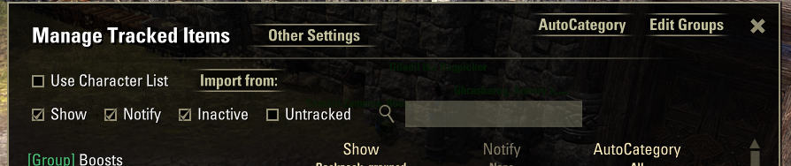
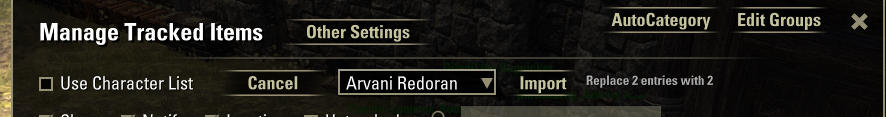
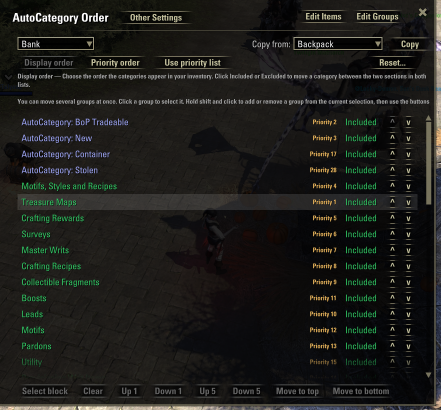

## Changes to the ui (and a bit of behaviour)
1. Make autocategory on/off account wide
2. Make everything apart from the item transfer delay and automerge chest stacks either/or 
3. Update the copy from to allow full profile copy of all settings

## make the edit tabs more consistent. 
ALL have the same top 
Title   [Main Settings]                 [Manage Items] [Manage Groups] [Manage Autocategory] (the one you are ON is greyed out) (this top bar should all line up)

When a character logs on check 
If they are account wide and have missing settings - merge them from defaults
If they are per character and have missing settings - merge them from account wide
When a character switches from per character to account wide do the same thing.
This should be a MERGE, keeping what is already set

the account wide, per character and copy tools need to move into the main settings panel. they are on only one of the config panels and that makes me sad

## Reference Images

use character list, import from and the other controls that pop up from that interaction move to the settings panel:

## Main settings panel how has this structure:

main settings
autocategory information -> expander panel and move to the bottom
lose the 'simulate button' and functionality

on screen indicators  -> change name to panel setup

Account wide settings: 
Main Settings
Item transfer delay     []
Auto merge chest stacks []

Main Settings
[] Use character settings / Use account wide settings
[copy] [from provfile] [go]

Display panels 
[Manage Items] [Manage Groups] [Manage Autocategories]

Item Tracker Panel
Show tracked items panel , group threshold etc.
but remove - use character specific list

Currency Panel (panel)
Storage Guauges (panel)
...

Integrations (panel)
If you also use autocategory, you can use inventory companion to manage your autocategory categories, and insert inventory companion groups into the order.
Enable Autocategory [] [manage autocategory categories]

You can use Tamriel Trace Cemter to classify your items, and use them in tracking groups for notification, autocategory etc.
Enable TTC []
TTC Groups (panel)
    Use the MINIMUM value of ttc to determine the group. These groups will be available to add to your tracking panel and be used with autocategory
    Trash < 100
    Low Level up to [ 100     ] gold per item
    Mid Level up to [ 1000     ] gold
    Expensive up to [ 5000     ] gold
    Superior up to  [ 10000     ] gold
    Amazing up to [100000]
    Jackpot > 100000

FCO Item Savere (Panel)
You can integrate with FCO Item saver to turn your fco classifications into groups. 
Enable []

Edit items panel
Make it single line. Show: Backpack, Grouped  Notify: none  AutoCategory: ......

Edit groups
Mostly fine - wire up the filter box

Edit autocategory
Bottom menu up 1 up 5 move to top space space Down 1 down 5 move to bottom
Make the info panel font bigger
Big Title: Display order:
Move the items up and down to set the order they appear in your inventory lists. You can hold down shift to select more than one group at a time.
Click on [Hide] to remove a group (so it doesn't appear in that storage area at all) or [Show] to unhide a group.

Big Title: Priority order:
When an item matches multiple groups, Autocategory will pick one based on a priority order. Move the groups up and down to set that order. You can hold down shift to select more than one group at a time. Click on Hide to remove a group (so it doesn't appear in that storage area at all or [Show] to unhide a group. 
The 'Other' group will contain any items that do not match any shown group filters.

button row: [Edit Display Order] [Edit Priority Order]                            Copy From  [source] [copy]

## other fixes
remove the [priority/display] warnings of different orders
remove the reset and [use priority] or [use otther]

Have a [Store Current Settings] [Reset to Last Stored Settings]  (scope to this view only - one context, one indexType)