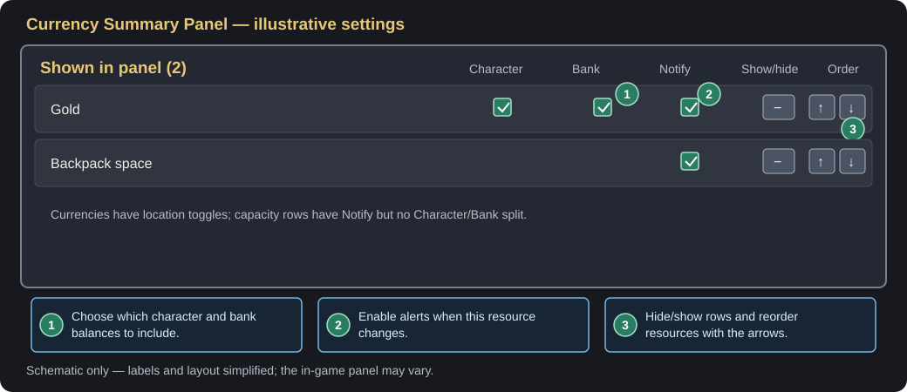
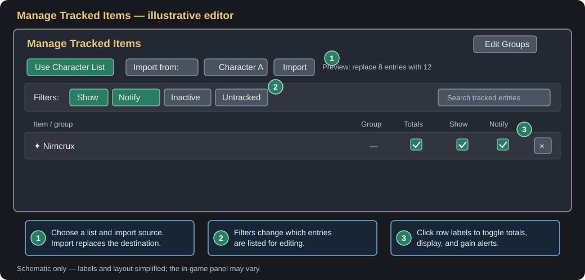
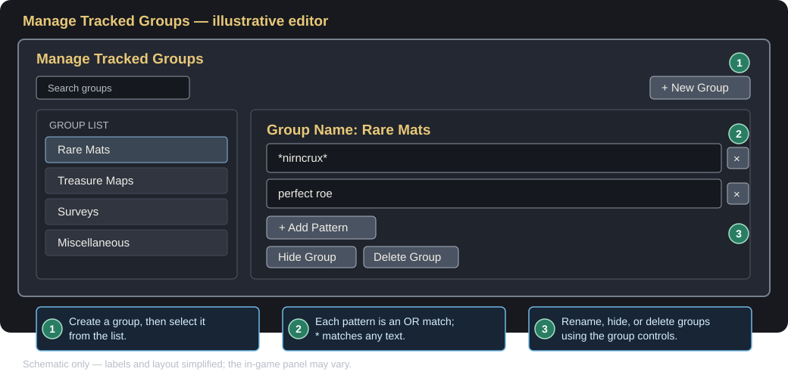

# Inventory Companion User Manual

Inventory Companion is an Elder Scrolls Online addon for inventory transfers, item tracking, currency monitoring, and capacity alerts. This guide explains the current in-game controls and workflows.

## Open the addon and tracking editor

1. In ESO, open **Settings > Add-Ons > Inventory Companion** to change addon options.
2. Open the tracked-items editor from the tracker panel's right-click menu, its edit icon, or the key assigned to **Show/Hide Tracking Settings** under **Settings > Controls > Keybindings > Inventory Companion**.
3. The editor has **Edit Items** and **Edit Groups** buttons to switch views. Right-click the tracker HUD for quick display options.

## Show currency and inventory resources

1. In the addon settings, open **Currency Summary Panel**.
2. For a currency, use its **Character** and **Bank** controls to choose which balances appear. Account-wide currencies do not have those location controls.
3. Use the row's show/hide button to include or exclude the resource from the panel. Hidden rows appear under **Not shown in panel**. Use the up/down arrows to change the order of shown rows.
4. **Show Empty Currencies** keeps currencies with a zero balance in the panel. Turn it off to show only currencies with a positive balance in at least one selected location.
5. Drag the currency panel to move it. Right-click it to toggle whether zero-balance currencies are shown.

The Currency Summary Panel and **Standalone Progress Bars** are independent. The progress-bar settings let you show or hide a separate bar for backpack space, bank space, or a supported capped currency. Drag a bar to reposition it. Its advanced settings control warning and danger thresholds and the normal bar color; shared alert colors control warning and danger colors.

## What the Notify controls do

There are two different kinds of Notify settings:

- **Item or group Notify:** In the tracked-items editor, click an item's **Notify** label to toggle an alert when the item is gained in the backpack. For a group, click **Notify** on the group entry to alert for items matching that group's patterns. This is separate from **Show**: an item can notify without being displayed on the tracker. Use the **Notify** filter at the top of the editor to find entries whose notifications are enabled.
- **Currency or capacity Notify:** In **Currency Summary Panel** settings, check **Notify** on a currency or on **Backpack space** / **Bank space** to receive an alert when that resource changes. Currency notifications work even if the currency row is hidden. These settings are separate from item and group notifications.

The item editor's **Show**, **Notify**, **Inactive**, and **Untracked** filters control which entries are listed for editing; they do not themselves enable or disable alerts. Click the label or checkbox to toggle a filter. **Untracked** adds currently carried or banked items to the editor so they can be added to your tracked list.

Currency and capacity alerts combine rapid changes into a single update and suppress startup/login changes. To disable one type of alert, clear Notify for its row.

## Track an individual item

1. Open the tracked-items editor.
2. To add an item currently in your inventory, right-click its item slot and choose **Add to Tracked Items**. Alternatively, enable **Untracked** in the editor. This will show ALL items you have, then you can just click **Show** or **Notify** on that item's row; this will add it to the current tracked list while enabling that option.
3. In the editor, click the item's **Show** label to show or hide it on the tracker, and click **Notify** to toggle gain alerts.
4. Click **Totals** to include bank holdings in the displayed count. By default, the tracker focuses on backpack counts.
5. Click the remove button on an item row to remove that item from the tracking list.

On the tracker HUD, left-click a group header to expand or collapse it. Right-click the HUD to show/hide empty tracked items, switch between single-line and multiline names, or open the editor.

## Create and edit a custom group

1. Open the tracked-items editor and select **Edit Groups**.
2. Select **+ New Group**. A new group is created and its name field opens; enter a name and press Enter or move focus away to save it.
3. Select **+ Add Pattern** to add a matching rule. Enter an item-name pattern, then move focus away from the field to save it. Add multiple patterns if needed; an item matching any one of them belongs to the group. Matching ignores letter case, and `*` matches any part of an item name. For example, `*treasure map*` matches names containing “treasure map”.
4. Return to **Edit Items** to adjust the group's **Show**, **Notify**, **Totals**, and **Group** settings. **Notify** alerts when a matching item is gained; **Totals** includes bank holdings; **Group** controls whether the rule is displayed as a group on the tracker.
5. In **Edit Groups**, use the group action buttons to hide/unhide or delete a custom group. Predefined groups can be reset to their defaults. The **Miscellaneous** group is a special catch-all and does not have editable patterns.

If the image does not appear in your Markdown viewer, [open the custom-groups schematic directly](./images/custom-groups-editor.svg).

## Use account-wide or character-specific lists

In the tracked-items editor, use **Use Character List** to switch between the shared account-wide list and a list specific to the current character. The character-list preference is stored per character.

To copy another list into the active destination:

1. Choose a source in **Import from:**.
2. Check the preview to see how many entries will be replaced and imported.
3. Select **Import** and confirm the replacement.

Import replaces the destination list and its rule overrides; it does not merge two lists.

## Deposit and withdraw crafted items

Assign keys for **Deposit Crafted Items** and **Withdraw Crafted Items** under **Settings > Controls > Keybindings > Inventory Companion**. Open a bank or storage chest, then use the relevant key. The addon queues supported items crafted by the current character and reports transfer progress. It will not transfer items outside its built-in crafted-item list.

**Auto-Merge Chest Stacks** in the addon settings controls whether matching backpack stacks are automatically moved into house storage chest stacks when the chest opens. This setting does not enable merging for the regular bank.

## Move part of a stack

With a bank, subscriber bank, or house chest open, right-click a stack with more than one item. Choose **Deposit 1** / **Withdraw 1** or the corresponding option for all but one item. These actions move only that stack quantity and are separate from the bulk crafted-item keybindings.

## Adjust tracker and transfer settings

- In **Item Tracker Panel** settings, **Show Tracked Items Panel** is the master visibility switch. **Tracker Group Threshold** determines when group headers are used; below the threshold, visible entries are shown as a flat alphabetized list. **Multiline Item Names** and **Show Empty Tracked Items** adjust the display.
- **Item Transfer Delay (ms)** controls spacing between queued bank transfers. Lower values may make transfers faster but can risk an ESO disconnect; keep the value conservative.
- In **Standalone Progress Bars**, each resource can be shown independently and has advanced threshold/color settings.
